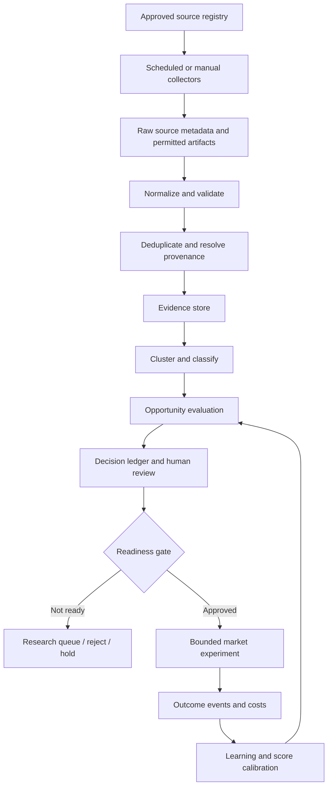

# 02 — System Architecture

## Design shape
Start as a modular monolith with clear internal contracts. One repository, one primary operational database, and a small number of background jobs are preferred until measured constraints justify more complexity.

## Logical flow

## Planes
### 1. Collection plane
Source registry, connector adapters, schedules, rate limits, quotas, retries, checkpoints, and collection-run logs. Connectors must be independently switchable.

### 2. Evidence plane
Normalized source records, source snapshots where permitted, canonical URLs, timestamps, content hashes, duplicate relationships, provenance, and retention/deletion metadata.

### 3. Intelligence plane
Classification, language/topic extraction, entity and alternative detection, cluster proposals, buyer/payer hypotheses, commercial-intent labels, counter-evidence, and opportunity scores. Model-generated outputs retain model/version/prompt metadata where feasible.

### 4. Decision plane
Human review queue, score explanation, confidence/coverage display, decision ledger, hold/reject/research/test decisions, and readiness-gate checklist.

### 5. Experiment and learning plane
Approved experiment definitions, landing-page/offer variants, permitted distribution actions, funnel events, transaction reconciliation, delivery outcome, refunds, repeat use, and unit economics.

### 6. Governance plane
Authentication and roles, secrets, source policy, audit logs, budget limits, kill switches, export/deletion processes, and incident handling.

## Runtime components
- Private operator UI.
- API / service layer.
- Relational database.
- Scheduled and queued background jobs.
- Connector interface and adapters.
- Optional object storage for permitted artifacts.
- Provider-agnostic model interface.
- CI tests and deployment workflow.
- Metrics, structured logs, and audit events.

## Reliability requirements
- Jobs are idempotent where possible.
- Retries use bounded backoff and do not bypass provider limits.
- Each run records started/finished time, source, cursor/checkpoint, items attempted, accepted, rejected, duplicates, errors, cost, and status.
- Partial failure is visible; no silent success.
- Source-specific failures must not stop unrelated connectors.
- A source can be disabled immediately without deleting historical evidence.

## Architecture boundaries
HIO owns research evidence and decision records. It does not replace HOLBERY's commerce/checkout systems or duplicate payment reconciliation. Any integration with a separate product repository is via documented APIs/events and least-privilege credentials.

## Initial deployment posture
Private/internal access only. Public endpoints, if technically required for callbacks, must expose only minimal authenticated or signed interfaces. The initial architecture does not imply that any cloud resource or integration is already deployed.

## Canonical productization baseline — 2026-10-12

HIO's intended direction is an AI Business Command Workspace: evidence → opportunity → approved execution → measurable outcomes. This is a target product direction, not proof that every capability is shipped or commercially ready. Keep fixture/demo evidence distinct from live data, and use [the canonical productization and production-parity contract](50-ai-workspace-productization-and-production-parity.md) for current capability labels, security boundaries, release verification, and SaaS launch gates. Current production login remains blocked until the Owner configures distinct `OPERATOR_SECRET` and `SESSION_SECRET` values securely and the deployed authenticated workflow is verified. Benchmark current Genspark AI Workspace and G2 product evidence before turning assumptions into requirements.

## Commercial SaaS direction update — 2026-10-16

Commercial architecture update (2026-10-16): separate public marketing pages, authenticated tenant workspaces, and owner/admin operations. FIND → BUILD → VALIDATE → LAUNCH is the customer flow. Enforce workspace scope in every API, job, query, artifact, quota, and audit record. Canonical target: [docs/64-public-saas-product-direction.md](64-public-saas-product-direction.md).
